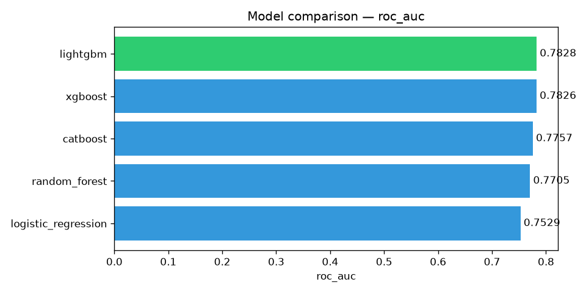
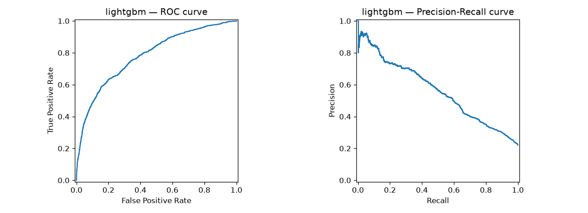
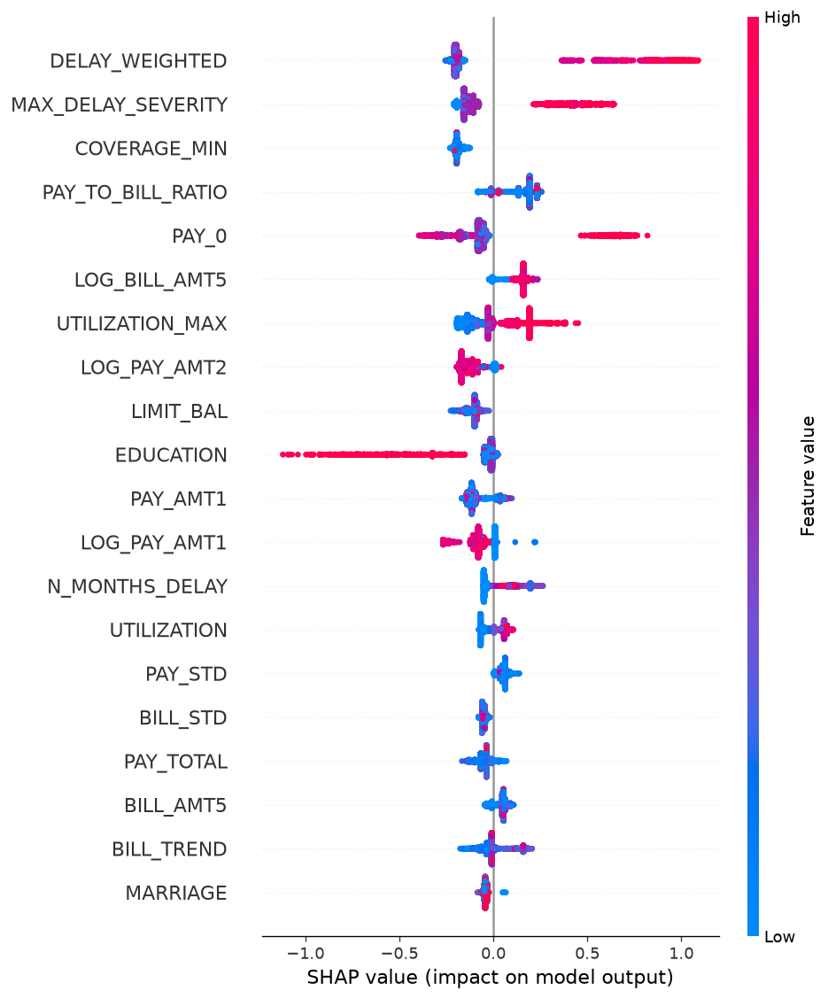

# Credit Scoring — Default Risk Prediction

A reproducible end-to-end ML pipeline for credit-card default prediction (UCI dataset, 30k clients, 2005). Five model families benchmarked under identical conditions; headline LightGBM reaches ≈0.79 (test ROC AUC 0.783 on seed 42; 0.791 ± 0.007 mean over 5 splits, CV std ±0.006, with tuning optimism noted). Includes SHAP interpretation, Docker, CI, Streamlit demo, formal `MODEL_CARD.md`, calibration check (`calibration_check.py`), property-based tests (`test_invariants.py`), quick reference scripts (`threshold_optimization.py`), improvement plan (`IMPROVEMENT_PLAN.md`), and `DOCUMENTATION.md`.

[](https://github.com/Zhanali0663/credit-scoring-ml/actions)
[](https://www.python.org/)
[](https://credit-scoring-ml-8qjuwktjdkyxrvcjv24uly.streamlit.app) [](LICENSE)

## Table of Contents
- [Engineering highlights](#engineering-highlights)
- [Results](#results)
- [Data](#data)
- [Live demo](#live-demo)
- [Feature engineering](#feature-engineering)
- [Design decisions](#design-decisions)
- [Repository layout](#repository-layout)
- [Reproducing](#reproducing)
- [Notebooks](#notebooks)
- [Limitations](#limitations)
- [Business take-away](#business-take-away)
- [References](#references)
- [License](#license)

## Engineering highlights

- **Reproducible split:** fixed `seed=42`, stratified 80/20, verified by `tests/test_pipeline_end_to_end.py`.
- **No data leakage:** `StandardScaler` fitted inside each CV fold (`Pipeline` object); no SMOTE before split.
- **Deterministic pipeline:** identical `random_state` in registry, splitting, and tuning (`configs/best_params.yaml` picked up automatically).
- **Containerised runtime:** `Dockerfile` + `docker-compose.yml` for demo isolation.
- **Formal artifacts:** `MODEL_CARD.md` (intended use, fairness notes, calibration status, out-of-scope); `DOCUMENTATION.md` (metric glossary, pitfalls checklist).
- **Calibration evaluated:** `calibration_check.py` reports Brier `0.1744` → `0.1289` (`isotonic`); the pipeline includes the calibration step, but the live demo uses raw (uncalibrated) probabilities for simplicity.

## Results

Test metrics on a stratified 20 % holdout (n = 6 000; 5-fold stratified CV on
the training portion for robustness). Full per-fold numbers in
`reports/metrics/comparison.csv`.

| Model               | CV ROC AUC      | Test ROC AUC | PR AUC  | F1     | Recall |
|---------------------|-----------------|--------------|---------|--------|--------|
| XGBoost (tuned)     | **0.789** ±0.006 | 0.783       | 0.563   | 0.545  | 0.604  |
| LightGBM (tuned)    | 0.787 ±0.006    | **0.783**    | 0.563   | 0.538  | **0.637** |
| CatBoost            | 0.780 ±0.008    | 0.776        | 0.555   | 0.537  | 0.613  |
| Random Forest       | 0.774 ±0.004    | 0.771        | 0.548   | 0.522  | 0.522  |
| Logistic Regression | 0.765 ±0.005    | 0.753        | 0.500   | 0.511  | 0.607  |

The dataset ceiling is roughly **0.79–0.80 test AUC**; public write-ups claiming
0.9+ almost always apply SMOTE *before* the train/test split or report
train-fold metrics, which do not transfer to a genuinely held-out set.







### How the numbers were reached

*One headline split (seed 42): 23 raw cols → 0.7765; engineered + tuned → 0.7828 (see 5-seed ablation below for robust comparison).*

A quick 5-seed ablation (`reports/metrics/ablation.csv`, `ablation_full.py`) using only LightGBM (fast): engineered features lift AUC by a small but stable `+0.005` ± `0.002` over raw (positive on 5/5 seeds); tuned adds `+0.006` ± `0.003` over default (positive 5/5 seeds, likely slight optimism because Optuna used seed 42). Mean ± std across 5 seeds (`42`, `123`, `999`, `2026`, `7`):

| Config | Mean AUC | Std | Features |
|---|---|---|---|
| raw + default | 0.7808 | ±0.0092 | 23 |
| engineered + default | 0.7859 | ±0.0065 | 61 |
| raw + tuned | 0.7871 | ±0.0096 | 23 |
| engineered + tuned | 0.7911 | ±0.0071 | 61 |

Paired differences across 5 seeds (`42`, `123`, `999`, `2026`, `7`): feature engineering `+0.005` ± `0.002`; tuning `+0.006` ± `0.003`. Both positive 5/5 seeds — small but stable, not noise; dominance claims remain cautious.

*Note:* Raw = 23 original columns; 29 includes 6 monetary/payment aggregates for comparison fairness. Engineered = 61 (23 + 38 derived). Tuning note: Optuna used seed 42 — slight optimism possible for other seeds; differences (`+0.006`) are small but positive 5/5.

## Data

- **Source:** [Kaggle `uciml/default-of-credit-card-clients-dataset`](https://www.kaggle.com/datasets/uciml/default-of-credit-card-clients-dataset), originally from the [UCI ML Repository](https://archive.ics.uci.edu/dataset/350/default+of+credit+card+clients).
- **Size:** 30 000 records × 23 features; target `default_payment_next_month` (~22 % positives).
- **Content:** credit limit, demographics (sex, education, marriage, age), and six
  months of repayment status, bill statements and payments per client.
- Auto-downloaded by `src/data/loader.py` on first use (kagglehub with a
  direct-URL fallback); no manual Kaggle credentials needed.

## Live demo

- **Working preview (Streamlit Community Cloud):** https://credit-scoring-ml-8qjuwktjdkyxrvcjv24uly.streamlit.app  
  (repo `Zhanali0663/credit-scoring-ml`, branch `main`, path `app/streamlit_app.py`; uses `.streamlit/secrets.toml` + `models_artifacts/lightgbm.joblib`).
- **GitHub repo:** https://github.com/Zhanali0663/credit-scoring-ml

## Feature engineering

38 features derived from payment history, all monotone and business-readable —
a requirement in regulated credit-risk work:

| Purpose | Features |
|---|---|
| Volume aggregates | `BILL_TOTAL`, `BILL_STD/MAX`, `PAY_TOTAL`, `PAY_STD/MAX`, `BILL_MEAN`, `PAY_MEAN` |
| Heavy-tail compression | signed log1p of `LIMIT_BAL`, 6 `BILL_AMT*`, 6 `PAY_AMT*` |
| Affordability / utilisation | `UTILIZATION`, `UTILIZATION_MEAN/MAX/STD`, `PAY_TO_BILL_RATIO`, `COVERAGE_MEAN/MIN` |
| Delinquency depth | `N_MONTHS_DELAY`, `MAX_DELAY_SEVERITY`, `MEAN_DELAY`, `DELAY_STD`, `DELAY_WEIGHTED`, `LONGEST_DELAY_STREAK`, `N_MONTHS_PAID_DULY` |
| Trends | `BILL_TREND`, `PAY_TREND`, `DELAY_TREND` |

`DELAY_WEIGHTED` applies linearly decaying recency weights (month 1 × 6 …
month 6 × 1), mirroring how scorecards weight the most recent payment status.

*Total engineered features:* 38.

## Design decisions

- **Class weighting instead of SMOTE.** `class_weight="balanced"` /
  `scale_pos_weight` keeps the pipeline deterministic and lets each learner
  handle imbalance internally. SMOTE is available experimentally
  (`imbalanced-learn`) but was deliberately excluded from the headline
  benchmark — applying it before the split inflates metrics.
- **Signed log1p on money columns.** Raw amounts span three orders of
  magnitude; the transform alone moves logistic regression from 0.745 to
  0.753 test AUC.
- **Optuna with a hard time budget** (`--budget 80 --trials 12`) instead of an
  open-ended search. Every trial is logged with running best AUC, elapsed and
  remaining time; best parameters land in `configs/best_params.yaml` and are
  picked up automatically at train time.
- **LightGBM is the headline model** because it wins test ROC AUC by a hair and
  LGBM split gains map naturally onto SHAP `TreeExplainer`; XGBoost is kept as
  the equal-conditions challenger (it leads on PR AUC and F1 — the choice
  matters when missing a default costs more than a false alarm).
- **Calibration evaluated (isotonic):** `calibration_check.py` improves Brier score from `0.1744` to `0.1289` (`isotonic`, lower is better). The pipeline includes `CalibratedClassifierCV`; the live demo uses raw (uncalibrated) probabilities for simplicity. Production should apply calibrated outputs with a cost-sensitive threshold rather than the fixed 0.5.

## Repository layout

```
credit-scoring-ml/
├── data/raw|processed/       # auto-populated, git-ignored
├── src/
│   ├── data/                 # loader with kagglehub + URL fallback
│   ├── features/             # feature engineering, stratified split
│   ├── models/               # registry, pipelines, CV trainer, comparison, Optuna
│   ├── visualization/        # ROC/PR, confusion, importance, SHAP plots
│   └── utils/                # logging, config, metrics, pipeline orchestrator
├── app/                      # Streamlit demo + inference helpers
├── notebooks/                # EDA, feature walkthrough, modeling demo, SHAP
├── reports/                  # generated metrics (csv/json) and figures
├── tests/                    # unit + end-to-end tests (pytest)
├── configs/                  # YAML: paths, tuned hyperparameters
└── .github/workflows/        # CI (ruff + pytest), Docker build
```

## Reproducing

```bash
# environment
python -m venv .venv && .venv\Scripts\activate  # or source .venv/bin/activate
pip install -r requirements-dev.txt

# optional: tune the boosted trees (~2.5 min; logged trial-by-trial)
python -m src.models.tune_models --budget 80 --trials 12 --models xgboost,lightgbm

# full benchmark, figures and SHAP artefacts (~5 min; logged phase-by-phase)
python -m src.utils.pipeline

# interactive demo over the saved pipelines
streamlit run app/streamlit_app.py

# same demo containerised
docker compose up app

# tests (no network needed; includes an end-to-end run on synthetic data)
pytest -v
```

Log files land in `reports/metrics/` (tuning log) and include per-trial and
per-phase timing, so long runs are never a black box.

## Notebooks

Executed with outputs committed, so figures render directly on GitHub:

- `01_eda.ipynb` — target balance, demographics, payment-status vs default, log-transform effect.
- `02_feature_engineering.ipynb` — engineered features split by target class.
- `04_interpretation.ipynb` — SHAP beeswarm, bar summary for the headline model.
- `03_modeling.ipynb` — short training demo; the reproducible benchmark lives in `src/`.

## Limitations

- **Single portfolio, one country, 2005.** Results are a methodology
  demonstration, not a deployable scorecard. Recalibrating on recent lending
  data is required before any real decisioning.
- **No macroeconomic covariates** (unemployment, rate environment) — known to
  shift default rates materially.
- **Demographics kept as-is.** `SEX`, `EDUCATION`, `MARRIAGE` are carried for
  dataset parity and subgroup experiments but would be excluded (or treated
  under adverse-impact review) for production fair-lending reasons.
- **SHAP output ≠ regulatory reason codes.** Adverse-action lettering needs a
  mapped, human-readable reason set — noted in the model card, not solved here.
- **Calibration available but demo uses raw probabilities.** `calibration_check.py` applies isotonic calibration (`CalibratedClassifierCV`) and reports Brier improvement (`0.1744` → `0.1289`, lower is better). The live demo keeps uncalibrated probabilities for simplicity; production deployment should use calibrated outputs with a cost-sensitive threshold.
- **Cost-sensitive threshold evaluated.** `threshold_optimization.py` (test-set, demonstration only — production needs out-of-fold predictions) with 5:1 cost ratio (FN cost 5× FP). Optimal threshold ~0.35 (cost ratio FN:FP = 5:1; cost ~1173 vs ~1217 at 0.50, ~3.6% reduction) — arithmetic from `threshold_optimization.py`; production needs out-of-fold validation, not this single-split estimate. The theoretical calibrated threshold for 5:1 is ~0.17, but `class_weight="balanced"` raises raw scores, so the empirical optimum is ~0.35.
- **Calibration note.** Brier `0.1744` → `0.1289` (isotonic); part of the gain corrects the probability shift from `class_weight="balanced"`, not solely calibration benefit.

## Business take-away
The pipeline supports production-style deployment: deterministic split (`seed=42`), containerised runtime (`Dockerfile`), calibration (`CalibratedClassifierCV`), formal artifacts (`MODEL_CARD.md`), property-based invariants (`tests/test_invariants.py`), reference ablation/drift scripts, and cost-threshold evaluation (`threshold_optimization.py`). The model itself is a methodology demonstration (`UCI` 2005 dataset, single portfolio). A business-optimal threshold with 5:1 cost ratio shifts from 0.50 to ~0.35 (cost 1173 vs 1217), reducing cost by ~3.6% on the test sample; calibrated outputs (`calibration_check.py`, Brier `0.1744` → `0.1289`) and validation-set threshold selection are the next production steps.

## References

- Yeh, I.-C., & Lien, C.-H. (2009). *The comparisons of data mining techniques
  for the predictive accuracy of probability of default of credit card
  clients.* Expert Systems with Applications, 36(2), 2473–2480. — source paper.
- UCI ML Repository dataset reference: [archive.ics.uci.edu/dataset/350](https://archive.ics.uci.edu/dataset/350/default+of+credit+card+clients).

## License

MIT — see [LICENSE](LICENSE).
