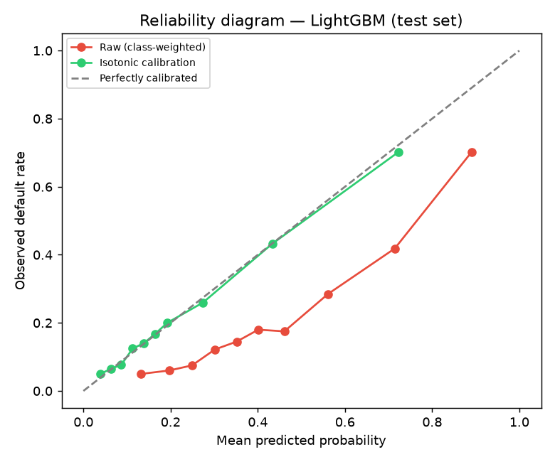
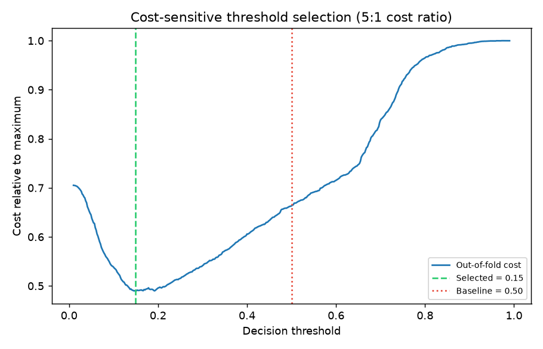

# Credit Default Prediction

[](https://github.com/Zhanali0663/credit-scoring-ml/actions)
[](https://www.python.org/)
[](LICENSE)

> 🔗 **Live demo:** https://credit-scoring-ml-8qjuwktjdkyxrvcjv24uly.streamlit.app/

An end-to-end, leakage-conscious ML pipeline that predicts credit-card default on
the UCI *Default of Credit Card Clients* dataset (30,000 clients, Taiwan 2005).
Five model families are benchmarked under identical conditions, followed by a
feature/tuning ablation, isotonic calibration, a cost-sensitive threshold study,
SHAP interpretation, tests, CI and Docker.

[Model card](MODEL_CARD.md) · [Method notes](DOCUMENTATION.md) · [Notebooks](notebooks/README.md)

## TL;DR

- **Best test ROC AUC: 0.783** (LightGBM 0.7828, XGBoost 0.7826 — effectively a tie).
  Mean over five 80/20 splits: **0.791 ± 0.007** for the tuned, engineered configuration.
- **Tuning is the reliable lever.** Optuna parameters add **+0.005 AUC** with raw
  features and **+0.009** with engineered features, positive on 5/5 seeds.
- **Feature engineering alone is a wash** (+0.0001 AUC, positive on 2/5 seeds).
  The 38 derived features only pay off after tuning (+0.0044, positive on 5/5 seeds).
- **Boosted trees beat logistic regression by ~0.03 AUC** (0.783 vs 0.753).
- Public 0.90+ results on this dataset often come from resampling before the
  split or from reporting train-fold metrics. We do not claim every such result
  is invalid; we simply keep the evaluation protocol explicit.

## Results

All five models use the same 61-feature engineered representation. Stratified
80/20 split (seed 42, test n = 6,000); 5-fold stratified CV on the 24,000-row
training part. F1/recall/precision use the raw model scores at the 0.5 cut-off.
Source: `reports/metrics/comparison.csv` and `.json`.

| Model               | CV ROC AUC    | Test ROC AUC | PR AUC | F1    | Recall | Precision |
|---------------------|--------------:|-------------:|-------:|------:|-------:|----------:|
| LightGBM (tuned)    | 0.787 ± 0.006 | **0.783**    | 0.563  | 0.538 | 0.637  | 0.466     |
| XGBoost (tuned)     | 0.789 ± 0.006 | 0.783        | 0.563  | 0.545 | 0.604  | 0.497     |
| CatBoost            | 0.780 ± 0.008 | 0.776        | 0.555  | 0.537 | 0.613  | 0.478     |
| Random Forest       | 0.774 ± 0.004 | 0.771        | 0.548  | 0.522 | 0.522  | 0.521     |
| Logistic Regression | 0.765 ± 0.005 | 0.753        | 0.500  | 0.511 | 0.607  | 0.442     |

> **Reading the table.** With n = 6,000 the standard error of test AUC is roughly
> 0.007, so the top three models are statistically indistinguishable. LightGBM is
> the headline model because it has the highest recall and a direct
> `TreeExplainer` fit, not because it "wins".


## Ablation: what actually helped?

LightGBM only, five seeds (`42, 123, 999, 2026, 7`), mean ± std of test AUC.
Each seed uses the same train/test rows for all four configurations. Code:
`src/models/ablation.py`; raw output: `reports/metrics/ablation.csv` and
`ablation_summary.json`.

| Configuration          | Features | Mean test AUC | Std    | Δ vs raw + defaults |
|------------------------|---------:|--------------:|-------:|--------------------:|
| raw + default params   | 23       | 0.7822        | 0.0077 | —                   |
| engineered + default   | 61       | 0.7822        | 0.0068 | +0.0001             |
| raw + tuned params     | 23       | 0.7870        | 0.0073 | +0.0049             |
| engineered + tuned     | 61       | 0.7914        | 0.0066 | +0.0092             |

Paired differences across seeds:

| Comparison                     | Mean Δ AUC | Std    | Seeds improved |
|--------------------------------|-----------:|-------:|---------------:|
| feature engineering, defaults  | +0.0001    | 0.0032 | 2 / 5          |
| feature engineering, tuned     | +0.0044    | 0.0018 | 5 / 5          |
| tuning, raw features           | +0.0049    | 0.0015 | 5 / 5          |
| tuning, engineered features    | +0.0091    | 0.0035 | 5 / 5          |

Two honest conclusions: the engineered representation is not a free win on its
own, and the Optuna search matters more than the feature work. The tuned
parameters were selected on seed 42, so the tuned rows are slightly optimistic
for the other seeds.

## Calibration and decision threshold

Both analyses are **demonstrations**, not production validation.
Code: `src/models/calibration.py` and `src/models/threshold.py`.

### Calibration

Class weighting (`class_weight="balanced"`) makes the raw model rank well but
inflates its probabilities: the raw test mean prediction is **0.426** against an
observed default rate of **0.221**. An isotonic `CalibratedClassifierCV`
(cross-validated inside the training set) fixes the scale without changing the
ranking.

| Metric               | Raw LightGBM | Isotonic-calibrated |
|----------------------|-------------:|--------------------:|
| Brier score          | 0.1806       | **0.1342**          |
| Log loss             | 0.5465       | **0.4273**          |
| ECE (10 bins)        | 0.2047       | **0.0111**          |
| Mean predicted       | 0.4259       | 0.2221              |
| Observed rate        | 0.2212       | 0.2212              |
| ROC AUC              | 0.7828       | 0.7828              |

Source: `reports/metrics/calibration.json`.



### Cost-sensitive threshold

With an assumed **5:1** cost ratio (a missed default costs 5× a false alarm), the
threshold is selected on **out-of-fold calibrated training predictions**, never
on the test set, and then frozen for one holdout evaluation.

| At threshold | Recall | Precision | F1    | Test cost (5·FN + FP) |
|--------------|-------:|----------:|------:|----------------------:|
| 0.50         | 0.351  | 0.672     | 0.461 | 4,532                 |
| **0.149**    | **0.805** | 0.345  | **0.483** | **3,319 (−26.8%)** |

The selected threshold is low because calibrated probabilities are small and a
miss is expensive. Note that the 0.637 recall in the model table is the **raw,
class-weighted** model at 0.5; after calibration the same cut-off is much
stricter (recall 0.351). The selected threshold restores high recall. A
different cost ratio produces a different threshold; the ratio is an
assumption, not a business fact. Source: `reports/metrics/threshold.json`.



## Methodology

- **No leakage.** `StandardScaler` lives inside a `Pipeline` and is fitted per CV
  fold. No resampling is applied before the split, and SMOTE is not used anywhere
  in the benchmark.
- **Imbalance (~22% positives)** is handled with `class_weight="balanced"` /
  `scale_pos_weight`; calibration then restores probability scale.
- **Reproducibility.** Fixed seed 42 for the split, CV and registry; each
  experiment writes its own JSON/CSV artifact. The ablation additionally varies
  the estimator seed per split.
- **Tuning.** Optuna with a hard time budget (12 trials, 80 s) for **XGBoost and
  LightGBM only**; parameters live in `configs/best_params.yaml`. CatBoost,
  Random Forest and Logistic Regression use documented defaults.
- **Features.** 23 raw columns + 38 derived = 61. Groups: volume aggregates,
  signed `log1p` of money columns, utilisation and payment-to-bill ratios,
  delinquency counts/streaks, recency-weighted delay, and trends.
- **SHAP.** `TreeExplainer` receives the **standardized** matrix the estimator
  was trained on; plots display the original feature values. Top drivers:
  `DELAY_WEIGHTED`, `MAX_DELAY_SEVERITY`, `PAY_0`, `UTILIZATION_MAX`,
  `COVERAGE_MIN`.

## Reproducibility

```bash
python -m venv .venv && source .venv/bin/activate   # Windows: .venv\Scripts\activate
pip install -r requirements-dev.txt

python -m src.utils.pipeline        # 5 models, CV, test metrics, figures, SHAP (~5 min)
python -m src.models.ablation       # 4 configs × 5 seeds
python -m src.models.calibration    # isotonic calibration + reliability figure
python -m src.models.threshold      # out-of-fold cost-sensitive threshold
python -m scripts.regenerate_shap   # refresh SHAP figures from the saved model
pytest -q                           # unit, invariant and end-to-end tests
```

| Command | Writes |
|---|---|
| `src.utils.pipeline` | `reports/metrics/comparison.{csv,json}`, `models_artifacts/*.joblib`, comparison/ROC/confusion/SHAP figures |
| `src.models.ablation` | `reports/metrics/ablation.csv`, `ablation_summary.json` |
| `src.models.calibration` | `reports/metrics/calibration.json`, `reports/figures/calibration_reliability.png`, `lightgbm_calibrated.joblib` |
| `src.models.threshold` | `reports/metrics/threshold.json`, `reports/figures/threshold_cost_curve.png` |
| `scripts.regenerate_shap` | `reports/figures/lightgbm_shap_{summary,bar}.png` |

`data/raw/`, `data/processed/`, `models_artifacts/` and `*.log` are gitignored;
the dataset and models are regenerated by the commands above. The dataset is
downloaded automatically on first use; no Kaggle credentials are required
(there is a direct-URL fallback). The figures and metric files are committed so
the README is checkable without retraining.

## Repository layout

```
├── src/
│   ├── data/            # loader (kagglehub + direct-URL fallback)
│   ├── features/        # feature engineering, stratified split
│   ├── models/          # registry, pipelines, CV, tuning, ablation, calibration, threshold
│   ├── visualization/   # ROC/PR, confusion matrix, importance, SHAP
│   └── utils/           # config, logging, metrics, pipeline orchestrator
├── app/                 # Streamlit demo + shared predict helper
├── notebooks/           # EDA, features, modeling, SHAP (executed outputs committed)
├── tests/               # unit, invariant and end-to-end tests
├── configs/             # paths, tuned hyperparameters
├── deploy/hf_space/     # optional Docker/Gradio Space
├── reports/             # metrics (csv/json) and figures
└── .github/workflows/   # CI: ruff + pytest
```

## Demo

The Streamlit app reads the saved pipelines from `models_artifacts/`, so run the
pipeline first:

```bash
python -m src.utils.pipeline
streamlit run app/streamlit_app.py          # http://localhost:8501
docker compose up app                       # same app in a container
```

The app shows the raw model probability and a configurable decision threshold.
A public live preview is available at
https://credit-scoring-ml-8qjuwktjdkyxrvcjv24uly.streamlit.app/ (free tier may sleep). The optional
`deploy/hf_space/` bundle can be published with `python -m scripts.deploy_hf`
using `HF_TOKEN` and `HF_REPO_ID` environment variables.

## Limitations

- **One portfolio, one country, 2005.** This is a methodology demonstration, not
  a deployable scorecard. It would need recalibration on recent lending data and
  macro covariates.
- **Protected attributes.** `SEX`, `EDUCATION` and `MARRIAGE` are kept for
  dataset parity and subgroup analysis. A production fair-lending model would
  exclude them or put them under adverse-impact review; no fairness metrics are
  computed here.
- **SHAP is not a set of regulatory reason codes.** Adverse-action notices need a
  mapped, human-readable reason set.


## References

- Yeh, I.-C. & Lien, C.-H. (2009). *The comparisons of data mining techniques for
  the predictive accuracy of probability of default of credit card clients.*
  Expert Systems with Applications, 36(2), 2473–2480.
- [UCI ML Repository: Default of Credit Card Clients](https://archive.ics.uci.edu/dataset/350/default+of+credit+card+clients)
  · [Kaggle mirror](https://www.kaggle.com/datasets/uciml/default-of-credit-card-clients-dataset)

## License

MIT, see [LICENSE](LICENSE).
